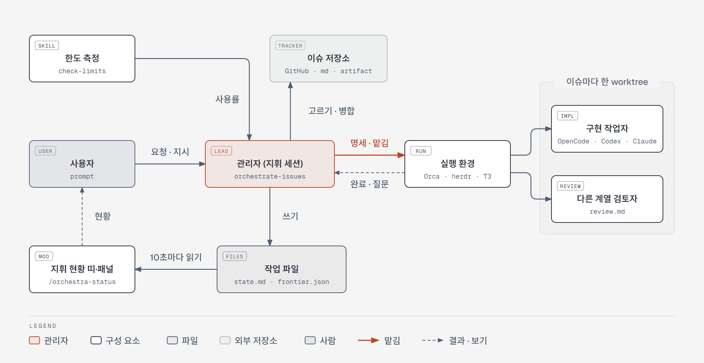
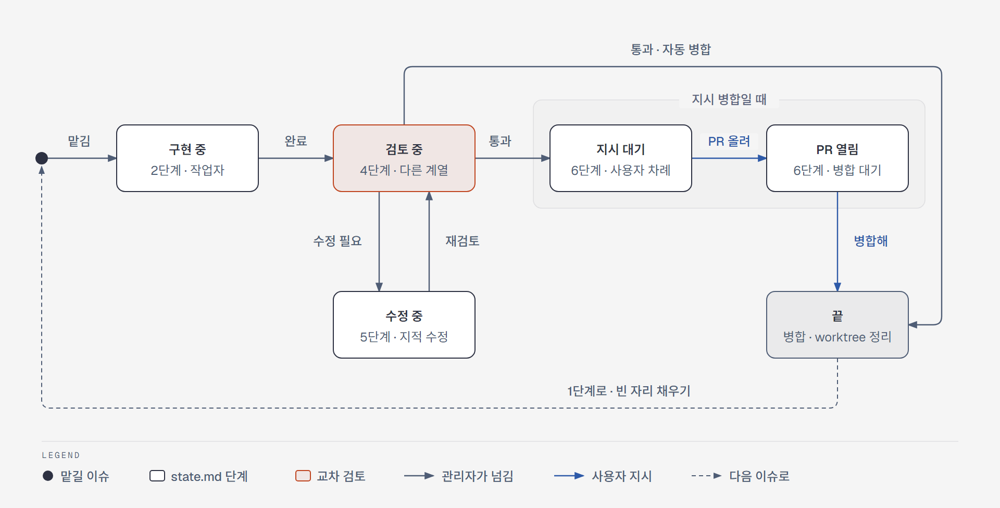

# agent-orchestra

> **이 저장소는 아카이브됐다(2026-11-14).** 지휘 기능은 [vstack](https://github.com/vananaHope/vstack) 플러그인으로 옮겼다. `/vstack:v-mode`, `/vstack:orchestrate-issues`, `/vstack:configure`를 쓴다. 이미 있는 프로젝트의 설정(`docs/agents/orchestration.md` 또는 `.local/orchestration/settings.md`)과 `~/.agent-orchestra/` 경로는 vstack이 그대로 읽는다. 이 저장소는 더 고치지 않는다.

Claude Code 플러그인. Orca·herdr app 위에서 여러 코딩 에이전트를 지휘해 GitHub 이슈를 처리한다.

- 실행 환경: Orca, herdr app 중 관리자 세션이 도는 곳을 알아서 골라 그 방법으로 작업자를 띄운다.
- 등급별 배치: 일마다 등급(light/standard/hard/max)을 정하고, 등급별 구현 목록과 검토 목록(OpenCode·Codex·Claude·관리자, 모델·추론 강도 포함)에서 작업자와 검토자를 고른다. 목록은 설정 창에서 정한다. 검토자는 구현자와 다른 계열이고, UI 작업은 Claude가 구현한다(검토 기본값은 Codex). OpenCode `plan`의 2차 의견을 언제 받을지도 정할 수 있다.
- OpenCode Go가 light·standard의 앞자리(범위가 분명한 구현·지적 수정·rebase)와 빠른 판단을 맡는다.
- Codex·Claude의 실제 사용률을 재서 한도가 차면 배치를 바꾼다(대체 모드, Claude 절약 모드).
- 이슈 의존 관계에서 임계 경로 순서로 고르고, 교차 검토를 통과하면 병합하고 worktree를 정리한다.

## 지휘 구성

관리자(`orchestrate-issues`를 부른 Claude 세션)는 코드를 쓰지 않는다. 한도와 이슈 저장소를 보고 일을 골라 실행 환경(Orca·herdr app)으로 작업자를 띄우고, 진행 상태를 작업 파일에 남긴다.

<picture>
  <source media="(prefers-color-scheme: dark)" srcset="docs/diagrams/orchestra-architecture-dark.png">
  
</picture>

작업 하나는 `state.md`의 단계를 따라 움직인다. 검토에서 지적이 나오면 수정과 재검토를 되풀이하고, 병합 방식이 `지시`면 사용자의 "PR 올려"·"병합해"를 기다린다. 끝나면 곧바로 1단계로 돌아가 빈 자리를 채운다.

<picture>
  <source media="(prefers-color-scheme: dark)" srcset="docs/diagrams/orchestra-lifecycle-dark.png">
  
</picture>

## 실행 환경

지휘 흐름(등급, 교차 검토, 판정, 병합)은 어디서나 같고, 작업자를 띄우고 기다리고 정리하는 방법만 실행 환경마다 다르다. 관리자는 지휘를 시작할 때 실행 환경을 정해 알린다. 사용자가 직접 말해도 된다.

| | Orca | herdr app |
| --- | --- | --- |
| 고르는 기준 | herdr app이 아닐 때 | 관리자 셸에 `HC_TERMINAL_ID`가 있음(herdr app 터미널 안) |
| 작업자 띄우기 | `orca orchestration worker-start` | `hc run --bg` |
| 같은 worktree에 검토자 | worktree id로 붙임 | 같은 `--cwd` |
| 완료·질문 받기 | `check --wait`, `reply` | 작업자가 `hc send`로 관리자에게 보고 |
| 방법을 적은 문서 | [orca.md](skills/orchestrate-issues/backends/orca.md) | [herdr.md](skills/orchestrate-issues/backends/herdr.md) |

## 설치

```
/plugin marketplace add vananaHope/agent-orchestra
/plugin install agent-orchestra@agent-orchestra
```

## 필요한 것

- `gh`(로그인), `codex`, `opencode` 명령
- 실행 환경 하나
  - Orca: `orca` 명령과 Orca의 `orchestration` 스킬
  - herdr app: herdr app과 `hc` 명령. 관리자 Claude Code를 herdr app의 터미널에서 연다
- Claude 사용률 측정: Claude Code 로그인(`~/.claude/.credentials.json`). Windows·Linux만 지원하고, macOS는 로그인 정보가 키체인에 있어 지원하지 않는다
- Python 3.10 이상(보조 스크립트)

## 프로젝트에서 쓰기

| 스킬 | 불리는 때 |
| --- | --- |
| `agent-orchestra:orchestrate-issues` | 이슈 구현, 다음 이슈·다음 묶음 진행을 요청할 때 |
| `agent-orchestra:check-limits` | Codex·Claude 한도를 물을 때(지휘 중에도 쓰임) |
| `/agent-orchestra:configure` | 직접 칠 때만. 프로젝트 설정을 설정 창으로 만들거나 고침 |

처음 쓰는 프로젝트에서는 지휘를 시작할 때 설정 창이 뜬다. 저장소를 훑어 찾은 값이 추천 선택지로 들어 있어서 대부분 고르기만 하면 된다.

프로젝트마다 고를 수 있는 것:

- **이슈 저장소**: GitHub 이슈, 로컬 md(형식은 프로젝트마다 지정), 아티팩트(데이터베이스로 상태까지 기록)
- **병합 방식**: `자동`(관리자가 PR·병합까지) 또는 `지시`(검토를 통과하면 멈추고 "PR 올려"·"병합해"·"병합됐어"·"리뷰 반영해" 지시를 기다림). 기본 브랜치와 병합 방법(merge/squash/rebase)도 지정
- **작성 규칙**: 메시지 언어, PR 서명 줄
- **설정 위치**: 저장소에 커밋(`docs/agents/orchestration.md`)하거나, 로컬에만(`.local/orchestration/settings.md`, `.git/info/exclude`로 제외)

설정이 없던 기존 프로젝트는 GitHub 이슈의 `ready-for-agent` 라벨, GitHub 이슈 의존 관계, 본문 체크리스트, `자동` 병합(`merge`)을 기본값으로 쓴다. 작업 파일은 각 저장소의 `.local/orchestration/`에 쌓인다.

## 구성

```
.claude-plugin/          플러그인·마켓플레이스 정의
docs/diagrams/           README의 지휘 구성·작업 단계 그림(HTML 원본과 라이트·다크 PNG)
skills/check-limits/     Codex·Claude 실제 사용률 측정(따로 불러도 됨)
  SKILL.md
  scripts/codex_limit.py, claude_limit.py
skills/configure/        설정 창으로 프로젝트 설정 만들기·고치기(사용자만 부름)
skills/orchestrate-issues/
  SKILL.md               역할, 배치, 시작 조건, 1~7단계
  backends/orca.md       실행 환경 Orca에서 작업자 띄우기·기다리기·답하기·정리하는 명령
  backends/herdr.md      실행 환경 herdr app(`hc`)에서 같은 동작
  trackers.md            이슈 저장소별 동작(GitHub, 로컬 md, 아티팩트)
  limits.md              한도 판정별 모드(대체 모드, Claude 절약 모드)
  tiers.md               등급 기준, 등급별 구현·검토 목록, 검토자 고르기, 관리자 확인, 맡김 기록
  opencode.md            OpenCode Go 조건, 모델·강도 주기, rebase
  codex-fast.md          Codex fast를 켤지 정하는 기준과 확인 방법
  fixes.md               수정 작업자와 재검토
  spec-check.md          맡기기 전 명세 새 눈 점검(맥락 없는 에이전트가 물을 것 받기)
  desktop.md             실창 검사 잠금
  ui-polish.md           관리자가 직접 하는 UI 다듬기
  setup.md               프로젝트 설정 만들기
  task-template.md, review-template.md, pr-template.md
  scripts/desktop_lock.py  실창 검사 차례 잠금(~/.agent-orchestra/desktop.lock), install로 고정 경로 ~/.agent-orchestra/bin/에 복사
  scripts/check_tiers.py   등급별 배치 표기의 모델·강도를 도구 목록과 대조
```

## 바꾸기

스킬을 고치면 `.claude-plugin/plugin.json`의 `version`을 올리고 커밋·push한다. 쓰는 쪽에서는 `/plugin marketplace update agent-orchestra`로 받는다.

## 라이선스

MIT. [LICENSE](LICENSE)를 본다.
