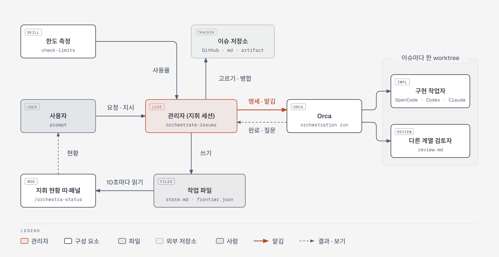
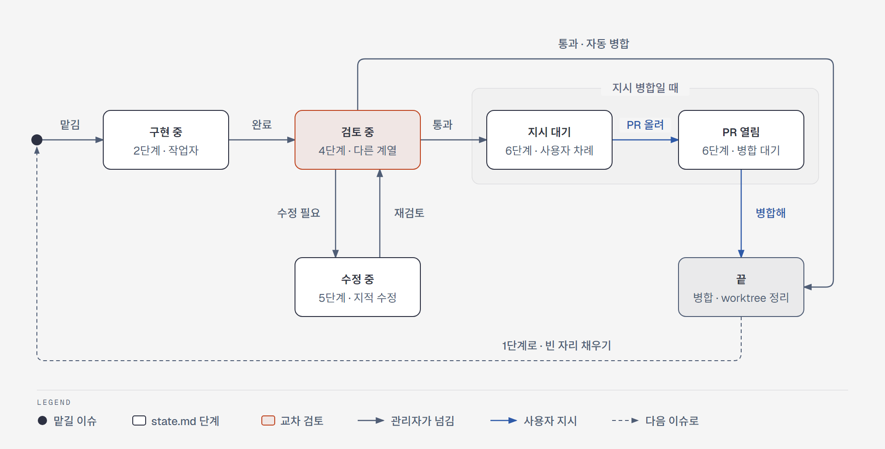
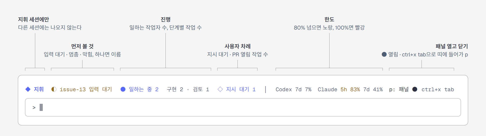
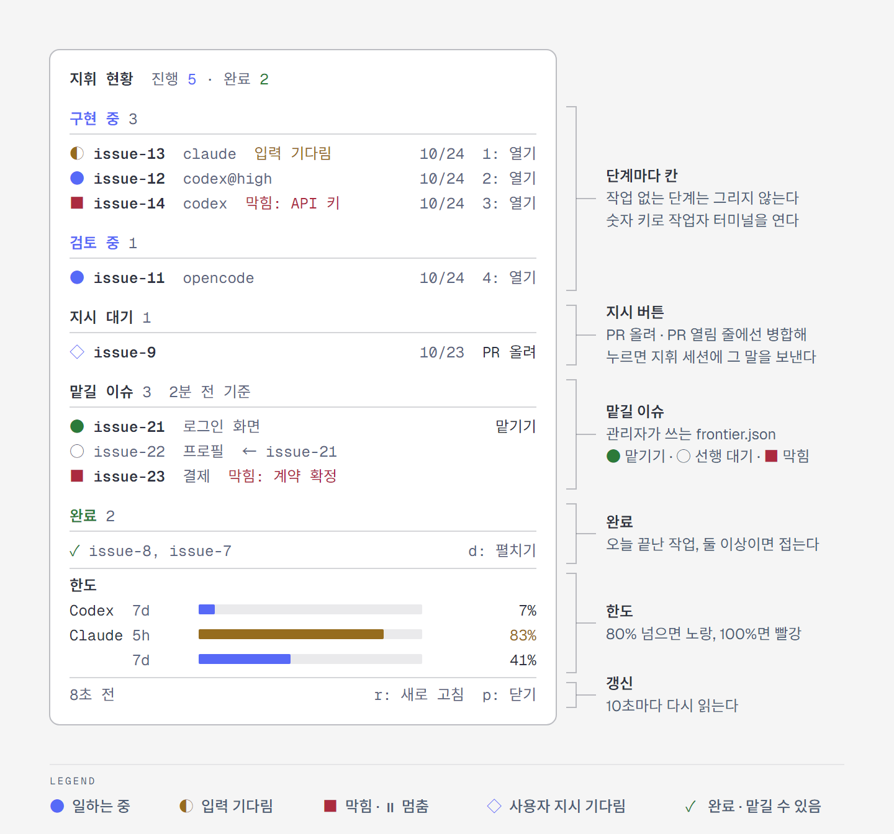

# agent-orchestra

Claude Code 플러그인. Orca 위에서 여러 코딩 에이전트를 지휘해 GitHub 이슈를 처리한다.

- 등급별 배치: 일마다 등급(light/standard/hard/max)을 정하고, 등급별 구현 목록과 검토 목록(OpenCode·Codex·Claude·관리자, 모델·추론 강도 포함)에서 작업자와 검토자를 고른다. 목록은 설정 창에서 정한다. 검토자는 구현자와 다른 계열이고, UI 작업은 Claude가 구현한다(검토 기본값은 Codex). OpenCode `plan`의 2차 의견을 언제 받을지도 정할 수 있다.
- OpenCode Go가 light·standard의 앞자리(범위가 분명한 구현·지적 수정·rebase)와 빠른 판단을 맡는다.
- Codex·Claude의 실제 사용률을 재서 한도가 차면 배치를 바꾼다(대체 모드, Claude 절약 모드).
- 이슈 의존 관계에서 임계 경로 순서로 고르고, 교차 검토를 통과하면 병합하고 worktree를 정리한다.
- 지휘 세션의 프롬프트 위에 지휘 상태 띠를, 옆에 작업별 패널을 보여 준다(작업 단계, 작업자 활동, 한도).

## 지휘 구성

관리자(`orchestrate-issues`를 부른 Claude Code 세션)는 코드를 쓰지 않는다. 한도와 이슈 저장소를 보고 일을 골라 Orca로 작업자를 띄우고, 진행 상태를 작업 파일에 남긴다. 띠와 패널은 그 파일을 읽어 보여 줄 뿐이다.

<picture>
  <source media="(prefers-color-scheme: dark)" srcset="docs/diagrams/orchestra-architecture-dark.png">
  
</picture>

작업 하나는 `state.md`의 단계를 따라 움직인다. 검토에서 지적이 나오면 수정과 재검토를 되풀이하고, 병합 방식이 `지시`면 사용자의 "PR 올려"·"병합해"를 기다린다. 끝나면 곧바로 1단계로 돌아가 빈 자리를 채운다.

<picture>
  <source media="(prefers-color-scheme: dark)" srcset="docs/diagrams/orchestra-lifecycle-dark.png">
  
</picture>

## 설치

```
/plugin marketplace add vananaHope/agent-orchestra
/plugin install agent-orchestra@agent-orchestra
```

## 필요한 것

- `gh`(로그인), `orca`, `codex`, `opencode` 명령
- Orca의 `orchestration` 스킬
- Claude 사용률 측정: [claude-hud](https://github.com/jarrodwatts/claude-hud)의 `~/.claude/plugins/claude-hud/config.json`에 `display.externalUsageWritePath`를 `~/.claude/claude-usage.json`의 절대경로(예: `C:/Users/<사용자>/.claude/claude-usage.json`)로 설정. claude-hud 0.11 이상이 필요하고, `~`로 쓰면 파일이 생기지 않는다
- Python 3.10 이상(보조 스크립트)

## 프로젝트에서 쓰기

| 스킬 | 불리는 때 |
| --- | --- |
| `agent-orchestra:orchestrate-issues` | 이슈 구현, 다음 이슈·다음 묶음 진행을 요청할 때 |
| `agent-orchestra:check-limits` | Codex·Claude 한도를 물을 때(지휘 중에도 쓰임) |
| `/agent-orchestra:configure` | 직접 칠 때만. 프로젝트 설정을 설정 창으로 만들거나 고침 |

처음 쓰는 프로젝트에서는 지휘를 시작할 때 설정 창이 뜬다. 저장소를 훑어 찾은 값이 추천 선택지로 들어 있어서 대부분 고르기만 하면 된다.

프로젝트마다 고를 수 있는 것:

- **이슈 저장소**: GitHub 이슈, 로컬 md(형식은 프로젝트마다 지정), 아티팩트(데이터베이스로 상태까지 기록)
- **병합 방식**: `자동`(관리자가 PR·병합까지) 또는 `지시`(검토를 통과하면 멈추고 "PR 올려"·"병합해"·"병합됐어"·"리뷰 반영해" 지시를 기다림). 기본 브랜치와 병합 방법(merge/squash/rebase)도 지정
- **작성 규칙**: 메시지 언어, PR 서명 줄
- **설정 위치**: 저장소에 커밋(`docs/agents/orchestration.md`)하거나, 로컬에만(`.local/orchestration/settings.md`, `.git/info/exclude`로 제외)

### 지휘 상태 띠와 패널

이 세션에서 `orchestrate-issues`가 불리면 프롬프트 위에 띠가 나온다. 다른 세션에는 나오지 않고, 그 세션에서는 읽기도 하지 않는다.

<picture>
  <source media="(prefers-color-scheme: dark)" srcset="docs/diagrams/orchestra-band-dark.png">
  
</picture>

- 작업 단계는 각 작업의 `state.md`, 작업자 활동(일하는 중·입력 기다림)은 Orca가 자기 훅으로 본 값(`orca orchestration worker-list`), 한도는 세션이 받은 Claude 창과 `check-limits`의 Codex 측정에서 온다. 10초마다 다시 읽는다(Codex 한도는 5분마다).
- 단계는 진행 중인데 작업자가 없거나 5분 넘게 쉬면 `⏸ 멈춤`으로 표시한다. 관리자가 `state.md`에 `막힘: <풀릴 조건>`을 적은 작업은 멈춤 대신 `■ 막힘: <조건>`으로 띠와 패널에 나온다.
- 패널: `/orchestra-status`(다시 치면 닫힘) 또는 띠의 `패널`. `/orchestra-status`로 열면 패널이 키를 받는다. Tab·화살표로 버튼을 고르고 Enter로 누르며, Esc로 프롬프트에 돌아간다. 띠의 `패널`로 열었거나 키가 프롬프트에 있으면 ctrl+x tab이나 클릭으로 패널에 들어간다. `p`(닫기)·`r`(새로 고침)·숫자(열기)는 패널이 키를 쥐었을 때만 눌리고, 프롬프트에서 친 글자는 그대로 들어간다.
- 패널은 `지휘 현황  진행 N · 완료 N` 아래 단계마다(구현 중·검토 중·수정 중·지시 대기·PR 열림, 맡길 이슈, 오늘 `끝`이 된 것은 완료) 칸을 나눠 이름·작업자·날짜(`MM/DD`)를 한 줄씩 보여 주고, `열기`로 그 작업자의 Orca 터미널 탭으로 간다. 작업이 없는 단계는 칸을 그리지 않는다. 기호 색이 활동이다: 보라 일하는 중, 노랑 입력 대기, 빨강 멈춤·막힘, 초록 완료. 완료가 둘 이상이면 `✓ issue-8, issue-7` 한 줄로 접고, `펼치기`(`d`)로 한 줄씩 본다.
- 지시 버튼: `지시 대기` 줄의 `PR 올려`, `PR 열림` 줄의 `병합해`(5초 안에 한 번 더 눌러야 보냄), 맡길 이슈 `●` 줄의 `맡기기`. 누르면 `issue-9 PR 올려`처럼 사용자가 칠 말을 지휘 세션에 그대로 보낸다. 지휘 세션이 일하는 중이면 그 턴이 끝난 뒤 들어간다. 보낸 버튼은 지휘 세션이 처리해 그 작업의 단계(맡길 이슈면 목록)가 바뀔 때까지 `보냄`으로 남는다. 10분이 지나도 그대로면 다시 누를 수 있다.
- 맡길 이슈: 관리자가 1단계마다 `.local/orchestration/frontier.json`에 쓰는 목록이다. `●` 바로 맡길 수 있음, `○` 선행 이슈 기다림(`← issue-21`), `■` 막힘(풀릴 조건)으로 보여 주고, 제목 옆에 목록을 쓴 지 얼마나 됐는지 적는다. 작업 폴더가 생긴 이슈는 진행 칸에 나오므로 여기서는 뺀다.

<picture>
  <source media="(prefers-color-scheme: dark)" srcset="docs/diagrams/orchestra-panel-dark.png">
  
</picture>

- 띠 끄기·켜기: `/orchestra-status off`, `/orchestra-status on`. 플러그인 설정의 `statusBand`(띠 사용), `pollSeconds`(갱신 주기)로도 정한다.
- Claude Code의 mod(함수 훅)를 쓴다. mod를 지원하는 Claude Code(2.1.287 이상)가 필요하다.

설정이 없던 기존 프로젝트는 GitHub 이슈의 `ready-for-agent` 라벨, GitHub 이슈 의존 관계, 본문 체크리스트, `자동` 병합(`merge`)을 기본값으로 쓴다. 작업 파일은 각 저장소의 `.local/orchestration/`에 쌓인다.

## 구성

```
.claude-plugin/          플러그인·마켓플레이스 정의(mod 설정 statusBand·pollSeconds 포함)
hooks/                   지휘 상태 띠·패널 mod
  register.tsx           띠·패널 그리기, 지휘 세션 판별, 주기적 읽기
  model.ts               state.md·frontier.json·Orca 작업자·한도를 상태로 바꾸는 순수 함수
docs/diagrams/           README의 지휘 구성·작업 단계·띠·패널 그림(HTML 원본과 라이트·다크 PNG)
types/index.d.ts         mod가 세션에 저장하는 값의 형식
tests/status.test.tsx    mod 테스트(`claude plugin test .`)
skills/check-limits/     Codex·Claude 실제 사용률 측정(따로 불러도 됨)
  SKILL.md
  scripts/codex_limit.py, claude_limit.py
skills/configure/        설정 창으로 프로젝트 설정 만들기·고치기(사용자만 부름)
skills/orchestrate-issues/
  SKILL.md               역할, 배치, 시작 조건, 1~7단계
  trackers.md            이슈 저장소별 동작(GitHub, 로컬 md, 아티팩트)
  limits.md              한도 판정별 모드(대체 모드, Claude 절약 모드)
  tiers.md               등급 기준, 등급별 구현·검토 목록, 검토자 고르기, 관리자 확인, 맡김 기록
  opencode.md            OpenCode Go 조건, 모델·강도 주기, rebase
  codex-fast.md          Codex fast를 켤지 정하는 기준과 worktree에 주는 방법
  fixes.md               수정 작업자와 재검토
  spec-check.md          맡기기 전 명세 새 눈 점검(맥락 없는 에이전트가 물을 것 받기)
  desktop.md             실창 검사 잠금
  ui-polish.md           관리자가 직접 하는 UI 다듬기
  setup.md               프로젝트 설정 만들기
  task-template.md, review-template.md, pr-template.md
  scripts/desktop_lock.py  실창 검사 차례 잠금(~/.agent-orchestra/desktop.lock), install로 고정 경로 ~/.agent-orchestra/bin/에 복사
  scripts/check_tiers.py   등급별 배치 표기의 모델·강도를 도구 목록과 대조
```

## 바꾸기

스킬이나 mod를 고치면 `.claude-plugin/plugin.json`의 `version`을 올리고 커밋·push한다. mod를 고쳤으면 먼저 `claude plugin validate .`와 `claude plugin test .`를 돌린다. 쓰는 쪽에서는 `/plugin marketplace update agent-orchestra`로 받는다.

## 라이선스

MIT. [LICENSE](LICENSE)를 본다.
